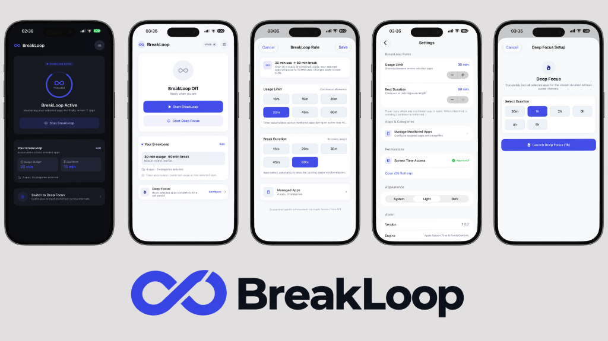
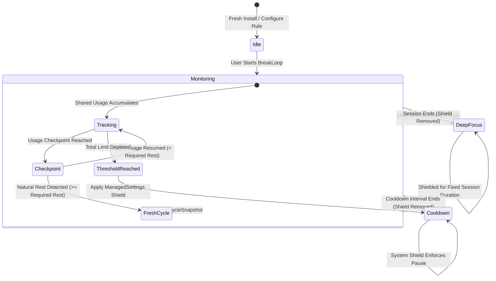

# BreakLoop

> A mindful Screen Time cycle for iOS.

<p align="center">
  
</p>

<p align="center">
  
  
  
  
  
</p>

---

## Overview

**BreakLoop** is a native iOS digital wellbeing and attention-management application designed to interrupt impulsive app-switching loops. 

Traditional screen time solutions apply static daily time limits to individual apps (e.g., 30 minutes of Instagram, 30 minutes of YouTube). When one limit is exhausted, users frequently jump to another distracting app—a behavioral pattern known as **app-hopping**.

BreakLoop solves this by establishing a **shared accumulated usage budget** across a user-selected set of monitored applications and categories:

```text
Instagram: 6 min
YouTube:   8 min
X:         6 min
----------------
Total:    20 min  →  Budget Exhausted  →  Automatic Cooldown Pause
```

When the combined usage reaches the threshold, BreakLoop shields the entire monitored group via Apple Screen Time APIs for an intentional recovery window (e.g., 15 minutes). Once the cooldown ends, the apps unshield automatically, initiating a fresh cycle.

BreakLoop is engineered strictly against Apple's official Screen Time APIs (**FamilyControls**, **DeviceActivity**, **ManagedSettings**, **ManagedSettingsUI**), running via system extensions in background processes without continuous polling by the main application, private APIs, or invasive content tracking.

---

## Key Features

- **Shared Usage Allowance**: Monitored apps draw from one pooled timer. Hopping between Instagram, TikTok, and X does not reset or evade the allowance.
- **Configurable Rhythm**:
  - **Usage Budget**: 5 to 60 minutes (default: 20 min)
  - **Rest Duration**: 15 to 60 minutes (default: 15 min)
- **Automatic Cooldown & Self-Unlock**: System-level shielding engages when the budget is reached and disengages automatically when the cooldown elapses.
- **Natural Rest Detection**: Recognizes when the user took a natural, intentional break between usage checkpoints and resets the cycle early without punishing the user with a forced shield.
- **Cycle Snapshot Isolation**: Active cycles run against immutable snapshots (`CycleSnapshot`). In-flight configuration edits apply cleanly to subsequent cycles without corrupting active timers.
- **Deep Focus Mode**: Immediate, fixed-session shielding for focused work without cyclical pauses (`30m`, `1h`, `2h`, `3h`, `4h`, `5h`). Selected apps are shielded immediately for the configured fixed session duration until the session ends and the shield is removed.
- **Screen Time Revocation Resilience**: Gracefully handles permission changes when authorization is altered in iOS Settings, disarming active shields and preserving user configuration.
- **Adaptive Native Design System**: Custom semantic tokens supporting responsive layouts across Compact, Standard, and Large viewports, Dynamic Type, and instant reactive Light/Dark/System theme switching.

---

## How BreakLoop Works



1. **Selection**: The user selects monitored apps, categories, or web domains via Apple's native `FamilyActivityPicker`.
2. **Monitoring**: The app schedules a continuous 24-hour daily `DeviceActivitySchedule` and sets threshold events on `DeviceActivityCenter`.
3. **Checkpoints & Natural Rest**: Dynamic sub-threshold checkpoints track cumulative usage over wall-clock time. If significant real-world time elapses with no active usage, a natural break is recognized.
4. **Enforcement**: If the full limit is exhausted without natural rest, `DeviceActivityMonitorExtension` calls `applyShield()` via a named `ManagedSettingsStore` and registers a `cooldown` activity.
5. **Recovery & Restart**: At the conclusion of the cooldown interval, `intervalDidEnd` removes the shield, clears transient state, and spins up a new cycle.

---

## Apple Frameworks & Technologies

BreakLoop relies exclusively on official, privacy-first Apple frameworks:

```
┌────────────────────────────────────────────────────────────────────────┐
│                               BreakLoop App                            │
│  ┌───────────────────────┐  ┌───────────────────────────────────────┐  │
│  │     SwiftUI Views     │  │        ViewModels & Services          │  │
│  │  (Dashboard/Settings) │  │ (Authorization / Storage / Controller)│  │
│  └───────────┬───────────┘  └───────────────────┬───────────────────┘  │
└──────────────┼──────────────────────────────────┼──────────────────────┘
               │                                  │
    IPC via App Group Shared Container (UserDefaults + Named Store)
               │                                  │
┌──────────────┼──────────────────────────────────┼──────────────────────┐
│              ▼                                  ▼                      │
│ ┌───────────────────────────┐      ┌─────────────────────────────┐     │
│ │   DeviceActivityMonitor   │      │ ShieldConfigurationExtension│     │
│ │         Extension         │      │     & ShieldActionExtension │     │
│ └───────────────────────────┘      └─────────────────────────────┘     │
│                       App Extensions Process                           │
└────────────────────────────────────────────────────────────────────────┘
```

### SwiftUI
The entire user interface is constructed declaratively with pure SwiftUI, adhering strictly to native iOS navigation patterns:
- Navigation push hierarchy for nested menus (`SettingsView`, `Manage Apps`).
- Modal sheets for ephemeral configuration (`BreakLoop Rule`, `Deep Focus Setup`).
- Adaptive layout helpers (`BLAdaptiveContainer`, `ViewThatFits`) ensuring layout consistency on compact devices (iPhone SE), standard iPhones, and Pro Max / iPad sizes without hardcoded offsets.

### FamilyControls
Provides privacy-preserving authorization and app selection:
- `AuthorizationCenter.shared`: Requests and validates Screen Time authorization (`.individual`).
- `FamilyActivityPicker`: Renders Apple's out-of-process picker. The application never receives bundle identifiers, app names, or browsing history; it only handles opaque `ApplicationToken`, `ActivityCategoryToken`, and `WebDomainToken` structures.

### DeviceActivity
Core engine for passive, out-of-process Screen Time usage monitoring:
- `DeviceActivityCenter`: Registers monitoring schedules and threshold events.
- `DeviceActivitySchedule`: Configures monitoring intervals (repeating daily windows for regular tracking; one-shot fixed intervals for cooldown and Deep Focus).
- `DeviceActivityEvent`: Configures usage thresholds (`DeviceActivityEvent.Name`) combining monitored tokens and target durations.
- `DeviceActivityMonitor`: Subclassed in `DeviceActivityMonitorExtension` to receive system lifecycle callbacks:
  - `intervalDidStart(for:)`
  - `intervalDidEnd(for:)`
  - `eventDidReachThreshold(_:activity:)`

### ManagedSettings
Controls app and web domain access restrictions:
- `ManagedSettingsStore`: Modifies `shield.applications`, `shield.applicationCategories`, and `shield.webDomains`.
- **Named Store Consistency**: BreakLoop uses a shared named store:
  ```swift
  ManagedSettingsStore(named: ManagedSettingsStore.Name("breakloop.enforcement"))
  ```
  Both the main app and all extension targets communicate through this identical store, avoiding out-of-sync enforcement.

### ManagedSettingsUI & Shield Action
- **ShieldConfigurationExtension**: Customizes the system shield display when a blocked application is launched. Contextualizes the screen based on whether the block is a **Normal Cooldown** (with remaining recovery time) or **Deep Focus** (with target completion timestamp).
- **ShieldActionExtension**: Adopts `ShieldActionDelegate` to handle user taps on shield buttons (e.g. dismissing the blocked application via `.close`).

### App Groups
Because app extensions run in sandboxed, independent processes with distinct memory spaces, state cannot be shared via in-memory singletons. BreakLoop utilizes App Group container:
```text
group.com.aliahmeterdogdu.BreakLoop
```
Shared state persisted via `AppGroupStorage`:
- `activitySelection` (`FamilyActivitySelection`)
- `cycleConfiguration` (`CycleConfiguration`)
- `activeCycleSnapshot` (`CycleSnapshot`)
- `cooldownEndDate` (`Date`)
- `usageCheckpointState` (`UsageCheckpointState`)
- `deepFocusSession` (`DeepFocusSession`)
- `isBreakLoopActive` (`Bool`)
- `appAppearance` (`AppAppearance`)

### OSLog & Persistent Diagnostics
- High-performance unified logging via `os.Logger` categorized by subsystem (`com.aliahmeterdogdu.BreakLoop`).
- Persistent, append-only **JSONL** log storage with automatic 512KB size rotation and background dispatch queues to facilitate diagnostic tracing across extension processes.

---

## Architecture

BreakLoop follows a **Feature-first MVVM with a shared Design System, a small Domain layer, and isolated Screen Time infrastructure**:

```text
BreakLoop/
├── App/                         # Application lifecycle & Root orchestration
│   ├── BreakLoopApp.swift       # @main entry point
│   ├── AppRootView.swift        # Root view routing (Onboarding vs Dashboard vs Revoked)
│   └── AppRootViewModel.swift   # Lifecycle and Screen Time permission state machine
│
├── Core/                        # Cross-cutting foundational modules
│   ├── Domain/                  # Pure business models and usage-cycle calculations independent from Apple frameworks
│   │   ├── Models/
│   │   │   └── BreakLoopDomainModels.swift # CycleConfiguration, CycleSnapshot, DeepFocusSession, UsageCheckpointState
│   │   └── Services/
│   │       └── UsageCycleCalculators.swift # CheckpointCalculator, NaturalRestCalculator
│   ├── DesignSystem/            # Design tokens, typography, colors, reusable components
│   │   ├── AppearanceController.swift # Observable root theme source-of-truth
│   │   ├── BreakLoopColors.swift      # Semantic light/dark color definitions
│   │   ├── BreakLoopTypography.swift  # Dynamic Type native font hierarchy
│   │   ├── BreakLoopResponsive.swift  # Breakpoint classification & adaptive containers
│   │   └── Components/                # BLCard, BLPrimaryButton, BLStatusRing, etc.
│   ├── Infrastructure/          # Low-level system & platform adapters
│   │   ├── ScreenTime/          # DeviceActivityService, ManagedSettingsService, AuthService
│   │   ├── Persistence/         # AppGroupStorage (UserDefaults container abstraction)
│   │   └── Logging/             # AppLogger, PersistentLogStore, LogCategory
│   └── Shared/                  # Cross-target identifiers & constants
│       └── DeviceActivityConstants.swift
│
├── Features/                    # Domain feature modules
│   ├── DashBoard/               # Home screen, live status ring, rule cards, deep focus entry
│   ├── FocusSetup/              # BreakLoop rule configuration sheet & preset selection
│   ├── Settings/                # Native grouped settings, rules, permissions, appearance
│   └── Onboarding/              # Permission explanation, request flow, revocation screens
│
├── DeviceActivityMonitorExtension/ # Out-of-process threshold & cooldown callbacks
├── ShieldConfigurationExtension/   # Custom Screen Time shield UI
├── ShieldActionExtension/          # Custom shield button delegate
└── Tests/                          # Lightweight standalone logic verification suite
```

---

## Core Engineering Decisions

### 1. Dynamic Checkpoints & Natural Rest Detection
Apple's Screen Time APIs intentionally **do not** expose real-time application open or close events for privacy reasons. To detect whether a user took a "natural pause" without forcing a shield, BreakLoop generates dynamic intermediate checkpoints:

```swift
let step = max(1, min(5, Int(ceil(Double(limitMinutes) / 12.0))))
```
- A 20-minute limit generates checkpoints at 2m, 4m, 6m, ..., 18m.
- A 60-minute limit generates checkpoints at 5m, 10m, 15m, ..., 55m.

When checkpoint $N$ triggers at timestamp $T_N$:
$$\text{ActiveUsageSeconds} = (M_N - M_{N-1}) \times 60$$
$$\text{WallClockSeconds} = T_N - T_{N-1}$$
$$\text{EstimatedRestSeconds} = \text{WallClockSeconds} - \text{ActiveUsageSeconds}$$

If $\text{EstimatedRestSeconds} \ge \text{RequiredRestSeconds}$, the user took an off-screen break long enough to satisfy their cooldown requirement naturally. The system wipes stale checkpoint state and restarts a fresh cycle without shielding their apps.

### 2. Snapshot Isolation Pattern (`CycleSnapshot`)
To prevent race conditions where a user changes their usage limit from 20m to 40m mid-cycle:
- When a cycle starts, an immutable `CycleSnapshot` is generated with its own UUID, timestamp, and rule parameters.
- Active monitoring and extension callbacks reference the active snapshot.
- Edits in `SettingsView` or `FocusSetupView` update `CycleConfiguration` in storage, but the active snapshot remains untouched until the ongoing cycle finishes or is naturally reset.

### 3. Cross-Process Consistency
- Extension processes (`DeviceActivityMonitorExtension`, `ShieldConfigurationExtension`) cannot rely on main-app memory.
- All persistent mutations write directly to `AppGroupStorage`.
- Both targets construct their `ManagedSettingsStore` using the exact same named store instance (`breakloop.enforcement`).

### 4. Reactive Unified Theme Engine
- To prevent theme desynchronization between Settings pickers and root window rendering, `AppearanceController` acts as the single `@MainActor` observable source of truth.
- `.preferredColorScheme(...)` is applied strictly at the root of `AppRootView`.
- Semantic colors use dynamic `UIColor { trait in ... }` providers, updating light/dark interfaces instantly without requiring an app reload or scene recreation.

### 5. Resilient Permission Revocation Handling
- If a user revokes Screen Time permissions in iOS Settings while BreakLoop is running, the app catches the revocation on scene activation (`scenePhase == .active`).
- It halts active monitoring, removes active shields, purges transient cycle snapshots, and transitions the UI to `PermissionRequiredView` while safeguarding user rules and app selections.

---

## Design System

BreakLoop features a custom semantic design system designed to feel like a first-class iOS utility:

| Token | Light Mode | Dark Mode | Usage |
| :--- | :--- | :--- | :--- |
| **`BLColor.background`** | `#F8F9FC` | `#0C0E14` | Primary Canvas (non-pure black) |
| **`BLColor.surface`** | `#FFFFFF` | `#161922` | Card & Container Surfaces |
| **`BLColor.surfaceSubtle`** | `#EEF1F8` | `#212533` | Controls, secondary pills |
| **`BLColor.textPrimary`** | `#12141A` | `#F5F6FA` | Primary Titles & Headlines |
| **`BLColor.textSecondary`** | `#61687B` | `#9BA3B8` | Body & Captions |
| **`BLColor.brandPrimary`** | `#434EE8` | `#BEC2FF` | Brand Accent & Interactive States |
| **`BLColor.divider`** | `#E4E7F0` | `#262A38` | Structural Hairlines |

- **Touch Targets**: All interactive controls satisfy Apple's $\ge 44 \times 44\text{pt}$ accessibility requirement.
- **Dynamic Type**: All font tokens scale natively from `.caption` to `.largeTitle`.

---

## Privacy Architecture

BreakLoop is engineered to uphold Apple's strict Screen Time privacy principles:
- **No Content Inspection**: BreakLoop never reads screen pixels, keypresses, messages, or notifications.
- **Opaque Tokens**: App choices are represented exclusively as opaque `FamilyActivitySelection` tokens. BreakLoop cannot extract application bundle identifiers, names, or icon graphics.
- **No Third-Party Telemetry**: No third-party analytics SDK or remote backend is currently used. All data stays local to the device and the sandboxed App Group container.

---

## Testing

The repository includes a lightweight standalone logic verification suite in [Tests/LogicTests.swift](Tests/LogicTests.swift):

```bash
swift Tests/LogicTests.swift
```

### Standalone Logic Verification (47/47 Passing)
1. **Checkpoint Generation**: Validates step calculation across 5m, 20m, and 60m limits.
2. **Natural Rest Calculation**: Asserts mathematical behavior across brief pauses (<15m) and natural pauses ($\ge 15\text{m}$).
3. **CycleSnapshot Isolation**: Verifies that active cycles remain locked to their originating parameters even after configuration updates.
4. **Deep Focus Session**: Verifies active windows, duration calculations, and post-expiry states.
5. **Authorization & Revocation**: Asserts state machine routing (`firstTimeOnboarding`, `authorized`, `permissionRevoked`), transient state clearing, and configuration preservation.
6. **Logger JSONL & Named Store**: Tests append-only log serialization, corrupt-line recovery, rotation boundaries, and store naming.
7. **Responsive Layout Metrics & Appearance**: Tests viewport classification (<360pt, 360–430pt, >430pt), padding adjustments, and theme Codable serialization.

---

## Requirements

- **iOS Deployment Target**: `26.2` (as configured in the Xcode project)
- **Swift Version**: `5.0` (as configured in the Xcode project)
- **Xcode**: A recent Xcode version capable of building the configured deployment target
- **Apple Developer Account** (Required to sign with the `Family Controls (Development)` entitlement for on-device testing)

---

## Getting Started

1. **Clone the repository**:
   ```bash
   git clone https://github.com/aliahmetbme/BreakLoop.git
   cd BreakLoop
   ```

2. **Configure Signing & Capabilities**:
   - Open `BreakLoop.xcodeproj` in Xcode.
   - Select your personal or team Apple Developer account under **Signing & Capabilities** for:
     - `BreakLoop`
     - `DeviceActivityMonitorExtension`
     - `ShieldConfigurationExtension`
     - `ShieldActionExtension`
   - Ensure the App Group (`group.com.aliahmeterdogdu.BreakLoop` or your personalized group ID) is checked across all four targets.

3. **Build and Run**:
   - Build using an actual physical iOS device (Screen Time APIs and FamilyActivityPicker do not function properly on iOS Simulators):
     ```bash
     xcodebuild -scheme BreakLoop -destination 'generic/platform=iOS' clean build CODE_SIGNING_ALLOWED=NO
     ```
   - On first launch, grant Screen Time access when prompted.

---

## Current Limitations & Engineering Notes

- **Simulator Limitations**: Apple does not provide full DeviceActivity and FamilyActivityPicker behavior in the Simulator. Functional verification requires a physical device with a configured Apple ID.
- **Coarse Resolution**: DeviceActivity callbacks are invoked by the system daemon with minor battery-optimizing delays. Threshold triggers are near real-time but not millisecond-exact.
- **Family Controls Entitlement**: Distribution via TestFlight or the App Store requires requesting the Family Controls capability from Apple.

---

## Author

**Ali Ahmet Erdoğdu**
- GitHub: [@aliahmetbme](https://github.com/aliahmeterdogdu)
- Repository: [https://github.com/aliahmeterdogdu/BreakLoop](https://github.com/aliahmeterdogdu/BreakLoop)

---

<p align="center">
  <sub>Built with Swift, SwiftUI, and Apple Screen Time APIs.</sub>
</p>
